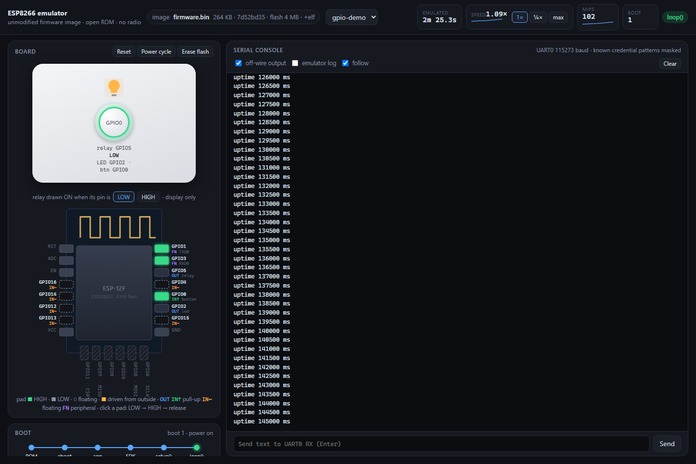
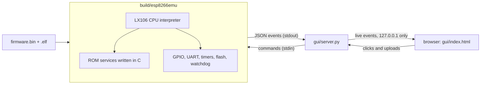

# ESP8266 Emulator

[](https://github.com/digitake/esp8266-emulator/actions/workflows/ci.yml)

Run ESP8266 firmware on your PC without a board. The emulator boots an unmodified
`firmware.bin`, shows its serial output, and lets you press its buttons and watch
its pins change. It can also record repeatable test reports.



*The GUI running [examples/hello](examples/hello): a live drawing of the module
with every pin, a faceplate for the button, relay and LED, and the serial console.*

## Is it for you?

Use it to:

- find out why firmware crashes or keeps resetting, without flashing a board;
- test buttons, relays and LEDs with exact, repeatable timing;
- check that firmware still behaves the same after a change;
- rehearse Arduino OTA updates.

Know its limits:

- **ESP8266 only**, not ESP32. Developed around Arduino core 3.1.2 and the
  NONOS SDK. Other firmware may call ROM functions that are not implemented yet.
- **No radio.** Wi-Fi scans find nothing. Instead, an experimental
  [virtual network](docs/NETWORKING.md) gives Arduino 3.1.2 firmware Wi-Fi that
  reaches only your own computer, so you can test MQTT and OTA against local
  services.
- **Idealized timing.** It counts one instruction per cycle and treats flash
  writes as instant. It is a functional debugger, not a cycle-accurate or
  electrical model.
- **Bring your own firmware.** No firmware, SDK or ROM dump is included. A small
  example sketch is.

## Quick start

### 1. Install the tools

You need Linux, or Windows 10/11 with WSL running Ubuntu. On Windows, first run
`wsl --install -d Ubuntu` in an administrator PowerShell, then open the Ubuntu
app. In Ubuntu:

```sh
sudo apt update
sudo apt install -y build-essential python3 git libslirp-dev libglib2.0-dev pkg-config
```

The last three packages are optional; they give dropped firmware its virtual
network. No Python packages, Node.js or frontend build are needed.

### 2. Get the code

```sh
git clone https://github.com/digitake/esp8266-emulator.git
```

### 3. Start it

- **Windows:** double-click `emulator.cmd` in the cloned folder.
- **Linux or the Ubuntu shell:** run `bash run-gui.sh` in the cloned folder.

The first start builds the emulator, which takes a minute. Then the GUI is at
**http://127.0.0.1:8266/**, and on Windows your browser opens it. Ctrl+C or
closing the window stops it.

To start it from any folder by typing `esp8266emu`, run `.\emulator.cmd -Install`
once in PowerShell.

### 4. Drop your firmware on the page

Drag `firmware.bin` and `firmware.elf` onto the page; PlatformIO writes both to
`.pio/build/<env>/`. The chip boots at once. The `.elf` lets the GUI show when
`setup()` and `loop()` start, and for an Arduino 3.1.2 image it switches on the
network. Every host name the firmware looks up then leads to your own computer.

No firmware yet? Build the example with
[PlatformIO Core](https://docs.platformio.org/en/latest/core/installation/index.html)
and drop the two files from `examples/hello/.pio/build/esp12e/`:

```sh
pio run -d examples/hello
```

Things to try with it:

- Click the **GPIO0** pad. The console prints `button pressed`, and GPIO5 goes HIGH.
- Type `hi` into the box under the console. The firmware answers `you typed: hi`.
- Press **Reset**, then **Power cycle**, and watch the Boot card's reset history.

Start with `.\emulator.cmd -ProfileFile examples\gpio-profile.json` (or
`bash run-gui.sh --profile-file examples/gpio-profile.json`) to also see the
example's button, relay and LED on a faceplate.

## What the GUI shows

| Part | What it gives you |
| --- | --- |
| Header | Image name and hash, emulated time, speed (1×, ¼× or max), MIPS, boot count, current stage |
| Board | ESP-12F drawing with each pin's live level and mode. Click a pad to drive it LOW, HIGH or release it. |
| Boot | ROM → eboot → app → SDK → `setup()` → `loop()` timeline, and the reason for every reset |
| Signals | Logic-analyzer trace of recent pin changes |
| Network | Soft AP and station state, as reported by the firmware; on the virtual network, its IP, packet counts and a link to its web server |
| Serial console | UART output with credentials masked; send text to the firmware |

The **Reset**, **Power cycle** and **Erase flash** buttons act like the real
thing. Flash contents the firmware saves, such as settings, survive restarts.
See [Use the GUI](docs/USER-MANUAL.md#6-use-the-gui) for every control.

## Beyond the GUI

| I want to… | Start with | Read more |
| --- | --- | --- |
| Run in a terminal or CI | `build/esp8266emu --flash fw.bin --speed 0 --max-seconds 10 --no-stdin --quiet` | [Run headless](docs/USER-MANUAL.md#9-run-headless) |
| Press buttons at exact times | A scenario file: `1000 in 0 0` drives GPIO0 LOW at 1 s | [Scenario scripts](docs/USER-MANUAL.md#10-scenario-scripts) |
| Find why a boot fails | The Boot card, the **emulator log** toggle, `--strict` | [Debug a boot](docs/USER-MANUAL.md#11-debug-firmware-that-does-not-boot) |
| Prove nothing changed | `scripts/evidence.py`, then `scripts/regression.py` | [Reports and regression](docs/USER-MANUAL.md#12-reports-regression-and-ota-tests) |
| Test an OTA update | `scripts/ota_rehearsal.py` with your own images, offline | [OTA tests](docs/USER-MANUAL.md#12-reports-regression-and-ota-tests) |
| Give firmware a network | Install libslirp and drop the `.bin` with its `.elf`; headless: `build/esp8266emu-net --net-profile …` | [The network in the GUI](docs/USER-MANUAL.md#the-network-in-the-gui) |
| Emulate an ESP8285 or a given flash size | `--chip esp8285` or `--flash-size 0x200000` | [Chip and flash](docs/USER-MANUAL.md#chip-and-flash-options) |

## How it works



The firmware runs instruction by instruction, exactly as it was built. The
emulator stands in for the chip's mask ROM and its peripherals; it never patches
the image. The GUI server only listens on 127.0.0.1 and refuses other host names.
[Architecture](docs/ARCHITECTURE.md) has the details.

## Repository layout

| Folder | Contents |
| --- | --- |
| `emulator.cmd`, `run-gui.sh` | One-command launchers for Windows and Linux |
| `src/` | The emulator in C: CPU, ROM services, peripherals, networking adapter |
| `gui/` | Local web server (Python standard library) and the single-page GUI |
| `scripts/` | Reports, regression, OTA, profiling and symbol tools |
| `tests/` | C and Python tests run by `make check` |
| `examples/` | The hello sketch, a GPIO profile and a regression manifest |
| `scenarios/` | A sample timed-input script |
| `docs/` | Manual, scope, architecture, testing and networking notes |

## Documentation

1. [User manual](docs/USER-MANUAL.md): start here. Install, GUI, headless runs,
   debugging, troubleshooting and a glossary.
2. [Current scope](docs/STATUS.md): what is implemented and what is not.
3. [Testing](docs/TESTING.md): regression fixtures, OTA tests and performance.
4. [Virtual networking](docs/NETWORKING.md): the experimental network adapter.
5. [Architecture](docs/ARCHITECTURE.md): how the emulator works inside, and its event protocol.
6. [Board comparison](docs/BOARD-COMPARISON.md): comparing against a physical board.

## Contributing

Bug reports and fixes are welcome. Run `make check` before you send a change,
and see [CONTRIBUTING.md](CONTRIBUTING.md) for what a good report includes.
Keep firmware, flash files and credentials out of issues and commits.

## License

[MIT](LICENSE). Firmware, SDKs and toolchains you use with the emulator keep
their own licenses. See [NOTICE.md](NOTICE.md) for reference material.
